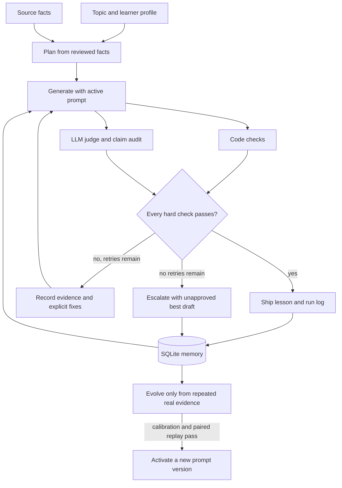

# Beginner Lesson Generator

A small, auditable agent that writes a beginner lesson, checks every hard
requirement, and only ships the lesson if all checks pass. The submission
topic is **Introduction to RAG**. The intended learner is a 12th-grade graduate
in India with limited English vocabulary, no technical background, and an
interest in starting an AI career.

The workflow uses LangGraph, a provider-agnostic OpenAI-compatible client,
reviewed local RAG facts, a versioned YAML rubric, and SQLite memory. It runs
offline with deterministic mock responses. Live-provider credentials are
read from `.env` or the process environment and must never be committed.

> **Current run status:** This workspace does not have live LLM credentials
> configured. [FINAL_LESSON.md](FINAL_LESSON.md) is a human-edited fallback
> that passed the local code checks and deterministic mock judge. It is not a
> real-provider generation or a real-model judgment. The evolution report
> labels prior mock runs separately.

## Architecture



The graph has plan, generate, evaluate, route, regenerate, ship, and
escalate-to-human nodes. The first draft plus at most two retries means no run
can make more than three lesson attempts. API call retries are separately
bounded. A failed lesson is never presented as approved.

## Quick start

Python 3.10 or newer is required.

### Windows PowerShell

```powershell
.\scripts\setup_venv.ps1
.\.venv\Scripts\Activate.ps1
python -m pytest -q
python -m src.cli run --topic "Introduction to RAG" --mock
```

### macOS or Linux

```sh
sh scripts/setup_venv.sh
. .venv/bin/activate
python -m pytest -q
python -m src.cli run --topic "Introduction to RAG" --mock
```

The setup scripts create `.venv` and install the pinned packages from
`requirements.txt`. Mock mode needs no API key. Run artifacts are written as
JSON and Markdown under `outputs/`; SQLite memory is written to
`data/memory.sqlite3`. Both locations are ignored by Git.

## Live provider configuration

Copy `.env.example` to `.env`, then set the provider values locally:

| Variable | Purpose |
| --- | --- |
| `MOCK_LLM` | `1` uses deterministic offline responses; set to `0` for live calls. |
| `LLM_API_KEY` | Secret key for the OpenAI-compatible endpoint. |
| `LLM_BASE_URL` | Endpoint base URL, such as `https://api.openai.com/v1`. |
| `GEN_MODEL` | Model name used to write lessons. |
| `JUDGE_MODEL` | Model name used for semantic checks. |

Keep `.env` untracked. Do not paste credentials into source code, reports,
screenshots, shell history, or Loom recordings. To make a live run after
configuring `.env`:

```powershell
# Windows PowerShell
$env:MOCK_LLM = "0"
python -m src.cli run --topic "Introduction to RAG" --max-retries 2
```

```sh
# macOS or Linux
export MOCK_LLM=0
python -m src.cli run --topic "Introduction to RAG" --max-retries 2
```

The CLI reports the final status, run ID, report paths, memory signals, lesson,
and rejection log. A provider/configuration failure exits with an explicit
error; it does not create a success-shaped lesson.

## Commands

| Command | Purpose |
| --- | --- |
| `python -m src.cli --help` | List the CLI subcommands. |
| `python -m src.cli run --help` | List run arguments and deliberate-error options. |
| `python -m src.cli run --topic "Introduction to RAG" --mock` | Generate and evaluate an offline lesson. |
| `python -m src.cli run --topic "Introduction to RAG" --inject-error jargon --max-retries 2 --mock` | Demonstrate a deliberate first-draft failure and bounded repair. |
| `python -m src.cli run --topic "Introduction to RAG" --max-retries 0` | Make one live attempt when `.env` enables live mode. |
| `python -m src.cli run --topic "Introduction to RAG" --max-retries 2 --output-dir outputs --memory-db data/memory.sqlite3` | Select retry limit, report folder, and memory database. |
| `python -m src.cli memory` | Display saved runs, check failures, effective fixes, and human feedback. |
| `python -m src.cli memory --memory-db path/to/memory.sqlite3` | Inspect a selected memory database. |
| `python -m src.cli feedback --run RUN_ID --note "..."` | Attach a note to an existing run. |
| `python -m src.cli feedback --run RUN_ID --note "..." --memory-db path/to/memory.sqlite3` | Attach feedback to a selected database. |
| `python -m src.cli evolve` | Report on history and consider a versioned prompt candidate. |
| `python -m src.cli evolve --memory-db path/to/memory.sqlite3 --report docs/evolution_report.md --changelog CHANGELOG.md` | Select evolution inputs and output paths. |
| `python -m scripts.calibrate --mock-only --report docs/calibration_report.md` | Run fixture calibration without a live provider and write the report. |
| `python -m scripts.calibrate` | Run mock calibration and, when live credentials are configured, real-provider calibration. |
| `python -m pytest -q` | Run all unit and end-to-end tests. |
| `.\scripts\demo.ps1` | Run the ordered offline Loom demo on Windows. |
| `bash scripts/demo.sh` | Run the ordered offline Loom demo on macOS/Linux. |

`run` also accepts `--inject-error false_claim`, `jargon`, `no_example`,
`bad_order`, or `long_sentences`; `--max-retries` accepts 0, 1, or 2.
`--mock` forces offline mode for that run. `memory` and `feedback` accept
`--memory-db`. The `evolve` options are `--memory-db`, `--report`, and
`--changelog`.

## Hard rubric

Every check in [rubric/v1.yaml](rubric/v1.yaml) is mandatory. A single failure
rejects the whole draft; checks are not averaged into a partial score.

| ID | Dimension | Type | Requirement summary |
| --- | --- | --- | --- |
| `ACC-01` | Accurate and grounded | LLM | Verify every atomic factual claim against supplied fact IDs; fail unsupported or contradicted claims. |
| `COVER-01` | Covers key points | Code | Put what, how, and why sections in the required order. |
| `BEGIN-01` | Beginner-friendly language | LLM | Explain ideas for a reader with no technical background. |
| `BEGIN-02` | Beginner-friendly language | Code | At least 90% of sentences are at most 20 words; none exceed 30. |
| `BEGIN-03` | Beginner-friendly language | Code | Approximate Flesch Reading Ease is at least 60. |
| `BEGIN-04` | Beginner-friendly language | Code | Avoid the configured list of unnecessarily difficult words. |
| `STYLE-01` | Beginner-friendly language | Code | Avoid listed idioms and limit listed phrasal verbs. |
| `JARG-01` | No unexplained jargon | Code | Define recognized technical terms near their first use. |
| `JARG-02` | No unexplained jargon | LLM | Catch other specialized terms that the deterministic list misses. |
| `GLOSS-01` | No unexplained jargon | Code | Include five required mini-glossary entries. |
| `EXAMPLE-01` | Teaches by example | Code | Include a familiar everyday example with at least 35 words. |
| `EXAMPLE-02` | Teaches by example | Code | Show at least three ordered steps in the example. |
| `EXAMPLE-03` | Teaches by example | LLM | Connect the analogy to retrieval, added context, and answer generation. |
| `COVER-02` | Covers key points | LLM | Substantively explain what RAG is, why it is useful, and its three steps. |
| `LIMIT-01` | Covers key points | Code | State a meaningful limitation in a limits section. |
| `FLOW-01` | Coherent teaching flow | LLM | Build from a plain definition to steps, example, and value or limits. |
| `LENGTH-01` | Beginner-friendly language | Code | Keep the lesson between 250 and 650 words, inclusive. |

The code checks measure observable properties. The semantic judge evaluates
meaning, flow, and grounding. The judge's evidence and any extracted claims are
stored in the run report.

## Memory and self-evolution

SQLite stores run outcomes, model and prompt/rubric versions, per-check failure
counts, retry instructions, whether an instruction fixed a failure on the next
attempt, and human notes. The generator receives a capped advisory summary of
recurring failures, proven fixes, and recent same-topic feedback. Source facts
and hard checks take priority over memory. Draft text, API keys, and evidence
quotes are not stored in the memory database.

`python -m src.cli evolve` uses at least three distinct **real** runs with the
same failed check and rubric version to identify a chronic failure. It can
write a new `prompts/generator_vN.txt`, but never overwrites an earlier prompt.
It activates a candidate only if the calibration suite remains fully passing
and paired real-provider replay over at least three distinct RAG topics
strictly improves first-pass rate. Mock results are reported separately and
never qualify for the chronic threshold or adoption.

## Design choices and trade-offs

- **Hybrid checks:** code checks are repeatable for measurable rules; an LLM
  judge covers meaning and flow that fixed patterns cannot assess.
- **One semantic judge:** lower cost and easier disagreement handling than
  multiple judges. It is still a fallible model, not a proof of truth.
- **Binary rubric:** no high score can conceal a missing mandatory requirement.
- **Two retries:** allow two corrective generations after the first draft while
  bounding run cost and guaranteeing termination.
- **Reviewed local facts:** easier to inspect for this focused RAG lesson than
  an open web search, but they constrain suitable topics.
- **Cautious evolution:** real repeated evidence, unchanged calibration, and a
  paired improvement gate are slower than automatic prompt editing, but keep
  changes reproducible and prevent mock behavior from appearing as real.

More detail is in [docs/DESIGN.md](docs/DESIGN.md) and
[docs/decisions/](docs/decisions/).

## Limitations and future work

- The reviewed source facts and evaluator are focused on RAG; other topics need
  their own reviewed evidence before they can be safely evaluated or replayed.
- The deterministic mock judge uses configured heuristics. For clean lessons,
  it does not perform a full independent semantic claim audit.
- A live judge can make mistakes. Its source-ID judgments still need human
  review; source support does not prove that a retrieved passage is complete.
- The readability formula and vocabulary lists are rough checks, not measures
  of a particular Indian learner's understanding.
- The current workflow does not implement a production retrieval index,
  document access control, crash resume, multilingual evaluation, or human
  approval UI.
- Future work: add reviewed non-RAG source packs, test with learners, track
  source-level citations in final lessons, add access-control cases, and gather
  real-provider replay evidence before adopting any prompt change.

## Demo and submission materials

- [FINAL_LESSON.md](FINAL_LESSON.md) — current mock-checked fallback lesson and
  status note.
- [docs/calibration_report.md](docs/calibration_report.md) — known-good/flawed
  fixture results and caveats.
- [docs/evolution_report.md](docs/evolution_report.md) — real/mock history
  separation and adoption decision.
- [docs/LOOM_SCRIPT.md](docs/LOOM_SCRIPT.md) — 18-minute recording plan.
- [docs/INTERVIEW_PREP.md](docs/INTERVIEW_PREP.md) — project-specific Q&A.
- [SUBMISSION_CHECKLIST.md](SUBMISSION_CHECKLIST.md) — submission readiness.
# self-evaluating-lesson-generator
