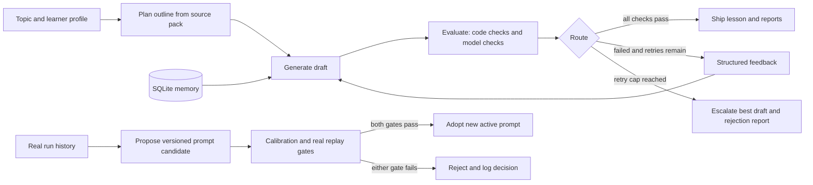

# Self-evaluating RAG lesson generator

A bounded LangGraph workflow that creates beginner-friendly lessons about retrieval-augmented generation (RAG), checks each draft against a versioned rubric, and either ships a passing lesson or escalates the best draft with a rejection report. A local SQLite memory records outcomes, while a separately gated command can propose prompt improvements from real runs.

The target learner is an Indian 12th-grade graduate who is new to technical subjects and prefers clear, simple English. The lesson is planned from zero knowledge and must explain the topic, its value, its steps, and a familiar worked example.

The included source pack and rubric are RAG-specific; changing the topic alone does not provide suitable facts or checks for an unrelated subject.

## Architecture



The graph state keeps the topic, outline, drafts, attempt results, feedback, retry count, and terminal status. Regeneration receives a reason, evidence, and a fix instruction for each failed check; the prompt also asks it to retain previously passing material. The retry cap is two regenerations (three drafts total), and only the all-checks-passing route can ship.

## Setup

Python 3.11 or newer is recommended.

### Windows (PowerShell)

```powershell
py -3.11 -m venv .venv
.\.venv\Scripts\Activate.ps1
python -m pip install --upgrade pip
python -m pip install -e .
python -m pip install -r requirements.txt
Copy-Item .env.example .env
```

### macOS

```bash
python3.11 -m venv .venv
source .venv/bin/activate
python -m pip install --upgrade pip
python -m pip install -e .
python -m pip install -r requirements.txt
cp .env.example .env
```

Mock mode is enabled by default and needs no credentials. For live calls, edit `.env` locally with `MOCK_LLM=0` and the provider's `LLM_API_KEY`, `LLM_BASE_URL`, `GEN_MODEL`, and `JUDGE_MODEL`. Never commit `.env` or paste a key into a report. A valid provider endpoint and key are required; live model availability and cost depend on that provider.

## Commands

Run commands from the repository root with the virtual environment active.

### Generate a lesson

```powershell
python -m lessongen.cli run --topic "Introduction to RAG" --mock --out outputs/demo
```

```bash
python -m lessongen.cli run --topic "Introduction to RAG" --mock --out outputs/demo
```

`run` accepts:

| Option | Meaning |
|---|---|
| `--topic TEXT` | Required lesson topic. |
| `--inject-error [false_claim\|jargon\|no_example\|bad_order\|long_sentences]` | Deliberately introduces one evaluator-detectable fault for a demo. |
| `--max-retries N` | Maximum regenerations after the first draft; must be between 0 and 2. |
| `--mock` | Use deterministic mock generation and evaluation instead of provider calls. |
| `--out DIR` | Write the lesson and attempt/rejection reports to this directory. |

Every run writes `rejection_log.json` and `rejection_log.md` as its full audit report. A passing run also writes `lesson.md`; an escalated run writes `best_draft.md` instead, and a failing lesson is not marked shipped. Reusing an output directory replaces the opposite-status draft file, so a stale passing lesson cannot remain beside a later escalated report. Reports include execution mode (`mock` or `live`), per-attempt check results, evidence, changes, final status, rubric/prompt versions, model names, token use, and latency. Generated run data and the SQLite database are ignored by Git.

### Reproducible demonstration

The scripts run a passing mock lesson, add feedback, catch and repair a deliberate false claim, show memory influence, and exercise the evolution gate. They retain their database and reports in a unique temporary directory and never call a live provider.

```powershell
.\scripts\demo.ps1
```

```bash
bash scripts/demo.sh
```

### Inspect and add to memory

```powershell
python -m lessongen.cli memory
python -m lessongen.cli memory --limit 10
python -m lessongen.cli feedback --run "<RUN_ID>" --note "Use a more familiar analogy."
```

`memory` prints recorded runs, failure counts/reasons, and whether a previous fix was followed by a passing check. `feedback` attaches a learner note to an existing run. Future generation gets a short lessons-learned block from failure history and recent notes; the run report records when that memory was used. SQLite data is stored under ignored `data/`.

### Propose a prompt evolution

```powershell
python -m lessongen.cli evolve
python -m lessongen.cli evolve --min-runs 3 --replay-topics 3 --mock
```

The command considers chronic failures across distinct real runs, proposes a new append-only prompt version, then compares it against the current prompt on a small replay set. Adoption requires both non-regressing calibration and a better first-pass rate on real replay. The minimum evidence thresholds (three runs and three replay topics by default) are intentionally small for a demo, not production-grade statistical confidence. Mock runs may exercise the flow but can never authorize adoption. Decisions and metrics are appended to `docs/evolution_report.md` and an ignored JSONL decision log; old prompts are not overwritten. The optional CLI flags are `--min-runs`, `--replay-topics`, `--mock`, `--report PATH`, and `--decision-log PATH`.

### Calibration and tests

```powershell
python -m scripts.calibrate
python -m scripts.calibrate --output docs/calibration_report.md
python -m scripts.calibrate --mock-only --report docs/calibration_report.md
python -m pytest -q
```

Calibration runs the labeled fixture set against evaluator checks. Use `--mock-only` to explicitly skip provider calls; `--report` and its `--output` alias select the report path. The current package uses `tests/fixtures/manifest_lessongen.json`; the preserved legacy calibration command uses `tests/fixtures/manifest.json`.

### Compatibility entry points

`python run.py --topic "Introduction to RAG"` and `python run.py --inject-error` forward to the current package CLI. `python -m lessongen.cli` is the primary entry point. The earlier implementation remains available through `python -m src.cli`; its modules, fixtures, and demo/setup scripts are retained for compatibility. `python -m src.optimize` forwards to the current gated evolution command.

## Rubric

The active rubric is [rubric/rubric_v1.yaml](rubric/rubric_v1.yaml). Every check is mandatory; a single failed check blocks shipping.

| Check | Requirement | Evaluator |
|---|---|---|
| `ACC-01` | Claims are grounded in the supplied source facts. | Model |
| `COVER-01` | Core sections are present and in the required order. | Code |
| `BEGIN-01` | Explanation suits a beginner. | Model |
| `BEGIN-02` | Sentences stay within the configured length. | Code |
| `BEGIN-03` | Readability meets the configured threshold. | Code |
| `BEGIN-04` | Avoids words on the configured plain-language denylist. | Code |
| `STYLE-01` | Avoids configured idioms and phrasal verbs. | Code |
| `JARG-01` | Defined technical terms are explained at first use. | Code |
| `JARG-02` | No other unexplained jargon remains. | Model |
| `GLOSS-01` | Mini glossary contains the required terms and definitions. | Code |
| `EXAMPLE-01` | Includes a sufficiently detailed, familiar example. | Code |
| `EXAMPLE-02` | Example follows the required ordered steps. | Code |
| `EXAMPLE-03` | Example accurately illustrates RAG. | Model |
| `COVER-02` | Covers what RAG is, why it matters, how it works, and its limits. | Model |
| `LIMIT-01` | Includes a meaningful limitation. | Code |
| `FLOW-01` | Concepts are introduced in a teachable progression. | Model |
| `LENGTH-01` | Lesson stays within the configured word-count range. | Code |

Code checks are reproducible but can be brittle to phrasing; model checks can vary and are not a substitute for expert review.

## Memory and evolution

Memory stores run summaries and per-attempt failures in SQLite, including reason, evidence, fix instruction, and whether a later attempt passed that check. Human notes are associated with run IDs. The generator receives only a short bounded summary, rather than the full run history.

Evolution is separate from ordinary lesson generation. It analyzes real history, writes a new candidate prompt instead of overwriting an old version, and requires calibration plus real replay evidence before promoting it. If evidence is insufficient, calibration regresses, or first-pass rate fails to improve, the candidate is rejected and the decision is logged. Mock outcomes are visibly labeled and cannot pass the real replay gate.

## Design and limitations

See [docs/DESIGN.md](docs/DESIGN.md) for the architecture rationale, failure handling, and trade-offs.

Known limitations:

- The supplied sources and rubric target RAG. Arbitrary topics need a matching source pack and rubric before their claims can be meaningfully evaluated.
- The replay and calibration sets are small; passing the gates is a demo-level signal, not statistical proof of quality.
- Model-based checks can be inconsistent, and code checks can reject valid alternate wording.
- Local SQLite memory is per-workspace and has no multi-user controls, retention policy, or review workflow for harmful feedback.
- Provider failures or invalid credentials stop live runs; mock mode is for deterministic development, not evidence of live quality.

Future work could add versioned topic-specific source packs, reviewer adjudication, broader calibration/replay data, and an evaluation dashboard with cost and quality trends.

## Assignment materials

- [FINAL_LESSON.md](FINAL_LESSON.md) is a human-edited, mock-checked fallback, not a live-provider-generated lesson.
- `outputs/final/lesson.md` is a deterministic mock run artifact and is ignored by Git; it is not live-provider evidence.
- [SUBMISSION_CHECKLIST.md](SUBMISSION_CHECKLIST.md) records the assignment deliverables.
- [docs/LOOM_SCRIPT.md](docs/LOOM_SCRIPT.md) and [docs/INTERVIEW_PREP.md](docs/INTERVIEW_PREP.md) contain presentation and interview materials.
- [CHANGELOG.md](CHANGELOG.md) and [docs/decisions/](docs/decisions/) preserve project history and design decisions.
