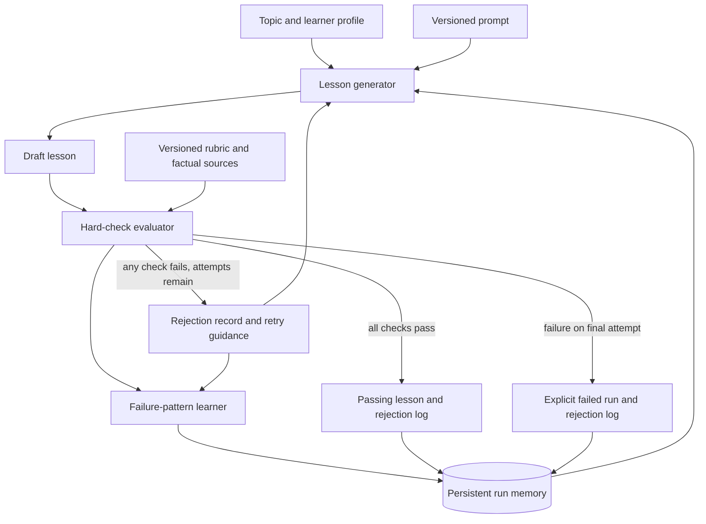

# Design: Reliable Beginner-Lesson Generator

## Problem framing

Generate a lesson for one requested topic and learner profile, then decide whether
it passes a fixed set of hard requirements. A failed lesson is rejected, its
failure is recorded, and a bounded retry receives the prior failure details.
Only a passing lesson is delivered as the lesson output; the rejection log is
delivered alongside it. If all attempts fail, the run ends explicitly as failed
and returns the complete rejection log rather than presenting a rejected lesson
as successful.

The submission topic is **Introduction to RAG**. The target learner is a
12th-grade graduate in India who has limited English vocabulary, has not studied
in an English-medium setting, has no technical background, and wants to begin an
AI career. The generator should explain what RAG is, why it matters, and how it
works, using familiar examples and short, direct language.

## Learner persona: what makes text difficult

- **Unfamiliar words carry extra load.** Terms such as *retrieve*, *embedding*,
  and *language model* can block understanding if they are introduced without
  an everyday explanation.
- **Long sentences are harder to decode.** Several clauses, passive voice, and
  abstract nouns can make a simple idea feel academic.
- **New ideas need a concrete anchor.** A familiar example (such as finding a
  page in class notes before answering a question) gives the learner something
  known to connect to the new idea.
- **The reasoning order matters.** Explain the problem first, then the main
  idea, then the steps, and only then why it is useful. This avoids asking the
  learner to hold unexplained details in memory.
- **Respectful simplicity is essential.** Use plain English without talking
  down to an adult learner. Define unavoidable technical words on first use
  and distinguish an analogy from how a real system works.

These are authoring constraints, not assumptions about a learner's ability.
Language checks should enforce observable properties (for example, short
sentences and explanations of required terms) rather than judge a learner's
intelligence or use a readability score as a proxy for understanding.

## Architecture

## Components and responsibilities

| Component | Responsibility |
| --- | --- |
| Configuration | Load environment settings, validate provider/model settings, and define the attempt limit and hard-check thresholds in one place. |
| Prompt set | Give the generator the audience, learning goals, source boundaries, expected structure, and actionable retry feedback. |
| Sources | Hold the small, reviewed factual basis used to check claims about RAG. No unsupported claim becomes grounded merely because a model repeats it. |
| Generator | Produce a structured lesson draft. It does not decide whether its own draft passes. |
| Evaluator | Apply binary checks for grounding/accuracy, beginner language, a teaching example, jargon explanations, required coverage, and coherent flow. Any failed mandatory check rejects the full draft. |
| Retry controller | Run generation and evaluation in a finite LangGraph cycle; pass only concrete prior failures to the next generation attempt. |
| Rejection log | Record attempt number, check, evidence, reason, and the change requested. Keep the final lesson separate from rejected drafts. |
| Persistent memory | Store run outcomes and learner feedback in SQLite across runs, with schema/version metadata and timestamps. |
| Failure-pattern learner | Aggregate repeated failure categories from past runs and produce versioned prompt/rubric refinement proposals. Keep the hard-check contract auditable; a refinement must be logged and validated before it can affect future runs. |

## State schema

The LangGraph state is a typed, serializable record. Persist only information
needed to resume/audit a run; never persist API keys.

| Field | Type | Meaning |
| --- | --- | --- |
| `run_id` | string | Unique ID used to associate graph state, logs, and memory records. |
| `topic` | string | Requested lesson topic. |
| `learner_profile` | object | Audience description and language/knowledge constraints. |
| `attempt` | integer | Current generation attempt, starting at 1. |
| `lesson` | string or null | Most recent generated draft; exposed as final output only after pass. |
| `check_results` | list of objects | Binary result per check, with evidence and explanation. |
| `rejection_log` | list of objects | One record per rejected attempt, including failures and requested changes. |
| `status` | enum | `generating`, `evaluating`, `passed`, or `failed`. |
| `memory_context` | list of objects | Relevant, bounded past failure patterns and approved refinements. |
| `prompt_version` / `rubric_version` | string | Versions used for reproducibility and audit. |
| `token_usage` / `latency_ms` | object | Per-call and aggregate operational measurements where available. |

## Termination argument

The initial generation is attempt 1. The controller increments `attempt` once
per completed generation/evaluation cycle. A failure routes to generation only
when `attempt < 1 + MAX_RETRIES`; with `MAX_RETRIES = 2`, there can be at most
three generated drafts. A pass exits immediately. A failure at attempt 3 exits
to the explicit failed-run output. Thus every run makes at most three
generation calls and cannot loop indefinitely, even if the generator repeatedly
produces the same invalid lesson or an external call fails. API retries are
separately bounded and do not change the graph attempt counter.

## Failure modes and mitigations

| Failure mode | Mitigation |
| --- | --- |
| A factual claim is plausible but unsupported | Ground claims against reviewed local sources; report source/evidence gaps as hard failures. |
| The lesson uses simple words but still assumes technical knowledge | Require a concrete teaching example, first-use definitions, and an ordered explanation of what/why/how. |
| The judge misses a failure or judges inconsistently | Use explicit, binary, evidence-bearing checks and deterministic code checks where possible; preserve judge output for audit. |
| The generator and evaluator share the same mistaken assumption | Keep evaluation instructions distinct from generation instructions and require source references for factual checks. |
| A retry repeats the same failure | Include exact failed checks and requested changes in the next prompt; log before/after outcomes. |
| A model/API is unavailable or returns malformed output | Use bounded exponential backoff for transient errors, validate structured output, and surface a clear terminal error; do not mark the lesson passed. |
| Memory contains noisy or harmful feedback | Store feedback as data, aggregate only repeated categories, keep provenance, and version/validate proposed refinements before use. |
| A run crashes between attempts | Persist the run ID, attempt, prior rejection records, and versions; resume only from a validated state. |
| Secrets leak to disk or logs | Read credentials from environment only; ignore `.env`; redact secret values from errors and telemetry. |

## Trade-offs considered

| Decision | Options | Chosen option and reason |
| --- | --- | --- |
| LLM judge vs code checks | Model-only judge; code-only checks; hybrid | **Hybrid.** Code checks enforce measurable requirements consistently; an LLM judge evaluates meaning and flow that simple string rules cannot. Both return evidence and binary decisions. |
| Number of judges | Single judge; multiple independent judges | **One structured judge, plus deterministic checks.** This keeps cost and latency appropriate for a small take-home while making objective constraints reproducible. Multiple judges add coordination and disagreement handling without guaranteeing truth. |
| Rubric output | Partial score; hard pass/fail | **Hard pass/fail.** A high score must not hide a missing required concept or unexplained jargon. The lesson passes only when every mandatory check passes. |
| Retry count | Unlimited; one retry; two retries; more retries | **Two retries after the first draft.** Three total attempts allow one meaningful correction cycle plus a second chance, while a strict counter guarantees termination and controls API cost. |
| Memory evolution | No memory; unrestricted self-editing; bounded, versioned learning | **Persistent, bounded, auditable learning.** Save feedback and rejection outcomes across runs. Repeated failures inform versioned refinement proposals; apply only validated refinements and retain the original hard-check requirements. This avoids silent rubric drift. |
| Source strategy | Model knowledge alone; large retrieval corpus; small reviewed source set | **Small local reviewed source set for this focused topic.** It is easy to inspect and cite in a take-home; the model's prior knowledge alone is not treated as evidence. |
| Failure behavior | Return best attempt as success; fail closed | **Fail closed.** If all drafts fail or evaluation cannot be completed, report failure and the rejection log rather than presenting an unchecked lesson. |

## Acceptance and observability

A successful run has exactly one final passing lesson and a rejection log that
contains every preceding rejected attempt (possibly empty on first-try success).
A failed run has no success-shaped lesson and records why each attempt failed.
Each check result contains `passed`, `reason`, and evidence; a retry record also
states what was changed or requested. Tests should verify the attempt bound,
all-checks-required behavior, log completeness, deterministic offline behavior,
and cross-run memory persistence.
