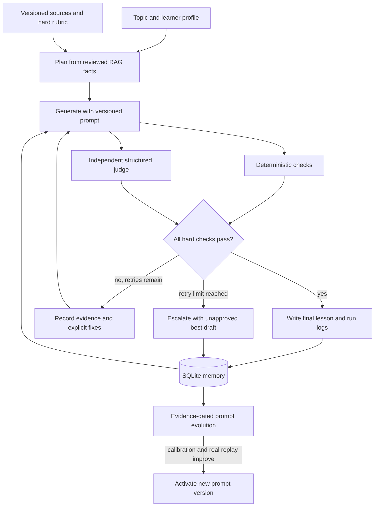

# Design: Self-Evaluating Beginner Lesson Generator

## Problem and learner

The system accepts a topic and creates a standalone lesson for an Indian
12th-grade graduate who is new to technical subjects and has limited English
vocabulary. It must not confuse fluent prose with learning: it needs to explain
the idea, teach it by example, and check its own claims before shipping.

Long sentences, unfamiliar terms, unexplained abbreviations, idioms, and
abstract explanations can make a lesson hard to follow. The lesson therefore
uses short sentences, defines technical terms close to first use, gives an
everyday Indian-context example, and follows a predictable teaching order.
These are practical writing constraints, not assumptions about the learner's
ability.

## Architecture

## Components and graph state

| Component | Responsibility |
| --- | --- |
| `config.py` | Load and validate environment settings and explain operational thresholds. |
| `llm.py` | OpenAI-compatible generation and judge calls, bounded retry, JSON parsing, usage metrics, and deterministic mock behavior. |
| `sources.py` | Load stable-ID paraphrased facts and citations for RAG. |
| `checks_code.py` | Deterministic checks for section order, readability, jargon, examples, glossary, style, and length. |
| `checks_llm.py` | Independent binary semantic checks and fact-ID-based atomic claim review. |
| `evaluator.py` | Combine every mandatory check and retain the rubric version. |
| `graph.py` | LangGraph plan, generate, evaluate, route, regenerate, ship, and escalation nodes. |
| `memory.py` | SQLite run history, failures, effective retry instructions, and human feedback. |
| `evolve.py` | Propose immutable prompt candidates and activate only after calibration and real replay gates. |
| `cli.py` | Run, memory, feedback, and evolution commands. |

Graph state contains the run ID, topic, learner profile, outline, source facts,
current and best drafts, attempts, check results, structured retry feedback,
rejection log, attempt count, final status, model/version identifiers, memory
signals, and token/latency totals. Secrets and full drafts are not stored in
SQLite.

SQLite records each failed check's reason and fix instruction, then links that
failure to the next attempt's result for an effectiveness count. Learner notes
are accepted with `feedback --run <id> --note "..."`. Up to three short prior
lessons are included in each generation prompt, and the per-attempt run report
records whether memory was used and which entries it supplied.

Evolution requires a check to fail across at least three distinct real run IDs.
It compares the current and proposed prompts on three or more distinct real-run
topics. It adopts only if fixture calibration does not regress and first-pass
rate improves on that replay set. Mock replay can exercise the gate but cannot
promote a candidate. Each decision appends before/after first-pass and retry
counts to `docs/evolution_report.md`; candidate and active prompt files are
immutable.

## Termination

Attempt 1 is the initial draft. The retry counter permits at most two further
drafts. Each failed evaluation either routes to regeneration while retries
remain or to human escalation when the limit is reached. A passing draft exits
to ship immediately. Therefore at most three lesson drafts are evaluated, and
a failed draft is never shipped as a success.

## Failure modes and mitigations

| Failure | Mitigation |
| --- | --- |
| Plausible but unsupported factual claim | Judge every atomic claim against the supplied fact IDs; fail unsupported or contradicted claims. |
| Model gives malformed JSON or provider is unavailable | Validate response shape, retry only transient errors with a bounded delay, and surface terminal failures. |
| Code patterns miss a jargon or flow problem | Use a separate semantic judge and preserve its exact evidence and reason. |
| Retry repeats the same flaw | Send the failed check, evidence, and explicit fix instruction; retain and compare attempts. |
| One noisy run changes future behavior | Memory is advisory; evolution requires repeated distinct real runs and a strict replay gate. |
| Retrieval facts are incomplete or topic mismatched | Keep this version focused on RAG and disclose that non-RAG topics require reviewed source packs. |
| Secret appears in output or version control | Keep `.env` ignored, never print its values, and exclude it from Git. |

## Decisions and trade-offs

| Decision | Options | Choice and reason |
| --- | --- | --- |
| Workflow | Plain functions; LangGraph | LangGraph makes routing, bounded retries, and escalation explicit and testable. |
| Acceptance | Scored rubric; hard pass/fail | Every required property blocks shipping; a high average cannot hide a critical failure. |
| Evaluation | LLM only; code plus LLM | Code is repeatable for measurable requirements; a judge evaluates meaning and flow. |
| Judge model | Same model; separate judge role | Separate model setting and prompt reduce direct self-approval and allow independent tuning. |
| Retries | Unbounded; one; two; more | Two retries allow correction while limiting cost and giving a simple termination proof. |
| Memory | None; flat file; SQLite | SQLite supports durable queryable history, per-check aggregation, and feedback effectiveness. |
| Evolution | Immediate self-edit; never learn; gated candidates | Versioned candidates need calibration and real replay improvement; old versions remain recoverable. |
| Sources | Model knowledge; web search at run time; reviewed local facts | Local cited facts make this focused take-home inspectable and avoid relying on unsupported model memory. |

## Calibration and evidence limits

Run `python -m scripts.calibrate --mock-only` from the repository root to evaluate
the four known-good lessons and eight deliberately flawed cases, then write
`docs/calibration_report.md`. The current package calibration uses
`tests/fixtures/manifest_lessongen.json`; the retained legacy calibration entry
point uses `tests/fixtures/manifest.json`. Each manifest records the expected
failed checks for its evaluator. A wrong-order lesson also introduces technical
terms before the definition, so both the flow and jargon checks are expected to
reject it.

The report includes lesson-level precision and recall, per-check precision and
recall, and the expected-versus-actual failed-check table. This calibration
command always uses the deterministic mock judge and does not load `.env`.
That makes the results reproducible and avoids provider calls, but it does not
prove that a live judge is factually correct. The fixture set is small and
focused on one topic; human review and broader live evaluation remain
necessary.
